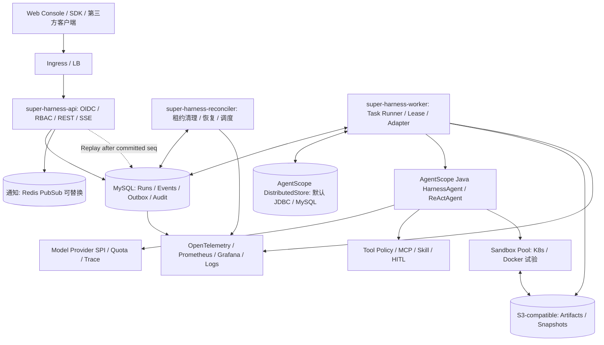
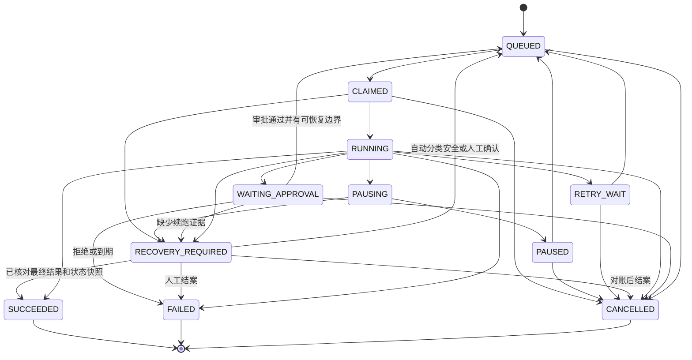
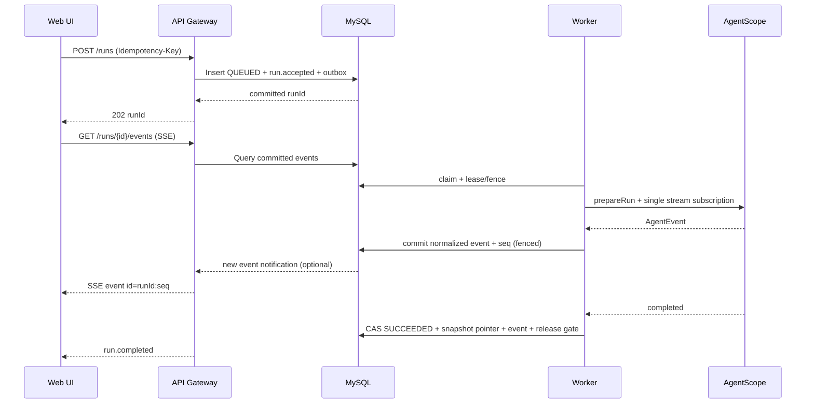
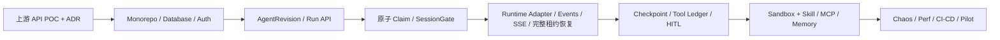

# super-harness：基于 AgentScope Java 2.0 的企业级 Agent Harness 平台

**研发实施方案 v1.2 · 2026-11-21**  
**定位**：可完全自主部署、可二次开发、支持多租户与长任务的通用企业 Agent 平台。  
**上游基线**：[`agentscope-ai/agentscope-java@v2.0.5`](https://github.com/agentscope-ai/agentscope-java/tree/v2.0.5)（生产基线；不直接依赖 main）  
**开发语言**：Java 21（上游要求 JDK 17+）；Maven 3.9+；Web 前端 TypeScript。  
**适用读者**：技术负责人、架构师、Java 后端、Agent 工程师、前端、SRE、安全与测试工程师。  
**文档状态**：研发设计与验收目标。工程代码位于项目根目录，最新实现、实测指标及试点待验事项见 [发布验收记录](../../docs/release-readiness.md)。

---

## 0. 执行摘要：最终技术决策

1. **Agent 主推理内核**：AgentScope Java `HarnessAgent` + `ReActAgent`，优先使用稳定发布的官方依赖，禁止未经 POC 就修改其 Agent Loop。
2. **企业运行控制**：super-harness 自研 `Run Manager / Scheduler / Lease & Fencing / Durable Event Store / Recovery Coordinator`。这些控制逻辑不能仅依赖上游 `AgentStateStore`。
3. **部署形态**：先以一个 Maven Monorepo 实现三个部署角色：`api`、`worker`、`reconciler`；共享领域模型与数据访问层。避免第一阶段做 10+ 个微服务。
4. **状态和事件**：MySQL 承载任务真相、业务状态和已确认 SSE 事件；AgentState 默认经独立 JDBC 数据源写入 MySQL，也可使用其他上游适配器；Redis/Valkey 可用于通知和缓存；S3 兼容对象存储承载文件和沙箱快照。
5. **隔离**：任何不可信代码执行必须进入沙箱；严禁把 `LocalFilesystemSpec` 默认宿主 shell 用在企业共享在线环境。生产优先 Kubernetes 隔离的按需 / warm-pool Sandbox。
6. **恢复**：先保证“已提交事件可重播、任务可识别、执行副作用不重复”；再实现可验证的安全检查点恢复。不能承诺模型已经输出的每个 token 都从同一个模型调用无损续写。
7. **模型和工具**：统一 Model Provider SPI、Tool SPI、MCP、Skills、审批与配额，避免第三方 SDK 暴露到平台核心域模型。
8. **开源合规**：平台可选择 Apache-2.0 许可；采购与交付前核查所有依赖的许可证、NOTICE、SBOM 和商用条款。
9. **研发节奏**：12–16 周、约 5–7 人的参考计划；第 6 周达到可演示纵向闭环，第 10 周完成可靠性闭环，第 16 周前具备生产试点资格（并非自动达成）。

### 0.1 为什么不直接使用 AgentScope Service

上游已经存在 Channel/Gateway 和 AgentScope Service 代码，可借鉴流式协议、任务路由和 UI。**但 super-harness 不把其预发布控制平面当作稳定的多租户业务后台**。先按自己的用户、租户、会话、任务、存储、审计等契约构建控制面，把 AgentScope 当可替换运行时。后续评估基于 main 的 `agentscope-durable`、`DurableRuntime`、`SessionBackend` 等新能力是否可在正式稳定版中替换我们的自研恢复模块。

### 0.2 重要的稳定版/主分支差异

- 已核实 `v2.0.5`：存在 `agentscope-core`、`agentscope-harness`、`agentscope-service`、`agentscope-extensions` 等模块；`AgentState` 主要在一次 call 退出时保存。
- 2026-11-21 的 `main`：存在额外 `agentscope-durable` 模块，开发版已提供 DurableRuntime、SessionBackend 和 Executor 契约，平台 Run 对应其 Turn，平台 attempt 对应其原生 Run。固定提交及职责映射见 ADR-001。**其类、模块与运行语义不能直接代入 v2.0.5 的代码。**
- 官方 v2.0.5 Release 修改过文件型消息队列布局、命名空间记忆读取语义、Redis Cluster 键布局选项和 SQL 字段定义，因此需要版本锁定、升级迁移和混合版本测试。

源：
- [v2.0.5 Release](https://github.com/agentscope-ai/agentscope-java/releases/tag/v2.0.5)
- [v2.0.5 Harness 架构](https://github.com/agentscope-ai/agentscope-java/blob/v2.0.5/docs/v2/zh/docs/harness/architecture.md)
- [v2.0.5 上生产指南](https://github.com/agentscope-ai/agentscope-java/blob/v2.0.5/docs/v2/zh/docs/others/going-to-production.md)
- [v2.0.5 核心上下文](https://github.com/agentscope-ai/agentscope-java/blob/v2.0.5/docs/v2/zh/docs/building-blocks/context.md)
- [main 当前架构（与稳定版不同）](https://github.com/agentscope-ai/agentscope-java/blob/21be74a8a3d584c54531ee04a58e91831c2d57f6/agentscope-durable/README.md)

---

Web 采用 AgentScope 官方 examples/web_ui/frontend 完整前端工程，根路径打开聊天页。前端调用本项目的 Java API，接口映射和验收用例见 [Web UI 前端复用](../../docs/upstream/WEB-UI.md)。

## 1. 目标、非目标与成功指标

### 1.1 P0 功能（必须提供）

- Web 管理台：租户、成员、Agent 定义/版本、对话、任务执行、运行历史、工具/Skill、模型配置、审计。
- Agent 运行：对话、连续上下文、工具调用、MCP、流式事件、取消、审批、工作区、Skill 配置、可选子 Agent。
- API：创建任务、查询状态、订阅 SSE、恢复事件、取消、审批/拒绝、查询产物、管理 Agent 版本。
- 执行控制：队列、租约、心跳、资源配额、限流、超时、重试、Draining、后台调谐。
- 存储：任务状态、已提交事件、AgentState、产物、审计、操作日志。
- 安全：OIDC/JWT、RBAC/资源权限、租户隔离、Secret、Tool 策略、文件访问控制、沙箱执行。
- 可观测：Run/Tool/Model Trace、Token/费用、错误率、恢复率、事件延迟、活跃任务、沙箱成本。

### 1.2 P1 功能（试点/增强）

- 多 Agent 委派与子任务调度、复杂 Plan Mode、长期记忆治理、Skill 版本市场、远程 Tool Worker、Agent 定时任务。
- 按 tenant/agent 的预算、模型自动路由、质量评测与回归测试、发布回滚。
- 沙箱 warm pool、负载感知扩容、低成本会话休眠、任务/Workspace 迁移。

### 1.3 不作为第一阶段目标

- 复刻上游所有 API 和组件；重写 LLM provider 或 ReAct 推理循环；自研数据库；推理中途原地恢复某个上游模型内部 KV cache。
- 所有多 Agent 交互都走独立跨机 RPC；全套低代码工作流设计器；为每名在线用户常驻独享一个 Pod。
- 在没有幂等/补偿接口的外部系统上宣称“绝对 exactly-once 业务副作用”。

### 1.4 建议 SLO（试点验收目标，非已达性能）

| 指标 | 目标/说明 |
|---|---|
| API 可用性 | 单区域 ≥99.9%（排除外部模型供应商停机需分开统计） |
| 已提交事件保真 | `run_id + seq` 不丢、不乱序、不重复持久化 |
| SSE 重播 | 客户端断连后可从 Last-Event-ID 补发，去重后不重复显示 |
| 任务丢失 | 对已接受且持久化的任务，0 个无记录消失 |
| 恢复识别时延 | Worker 强杀后 在 60 秒租约、最长 10 秒巡检间隔下，目标 75 秒内进入可恢复/待处理状态（目标） |
| 租户隔离 | 交叉租户访问测试 100% 拦截 |
| 对外部副作用的重试 | 仅业务幂等或权威确认原请求未执行且不会迟到执行时自动重试 |
| MVP 并发测试 | 100 活跃会话，500 连接的压测基线；实际承载需按模型 QPS/Token 限额规划 |
| 质量回归 | 固定任务集工具成功率、完成率、Groundedness、成本与 p95 可重复对比 |

---

## 2. 总体技术架构



### 2.1 部署角色与职责（先保持 3 个进程）

| 进程 | 职责 | 不做什么 |
|---|---|---|
| `super-harness-api` | OIDC/JWT，租户授权，Agent 配置 API，Run 提交，状态查询，事件重播、实时订阅，审批 API | 不持有 Agent Loop，不负责长任务执行 |
| `super-harness-worker` | Claim 任务、维护租约、创建 AgentScope Runtime、收集事件、管理工具/审批/结果、释放资源 | 不把某个 HTTP 连接作为任务生命周期 |
| `super-harness-reconciler` | 任务恢复调谐、异常租约检测、重试排队、审计/配额修复、周期清理 | 不直接推理、不强制重试不可验证副作用 |

Monorepo 内允许共享模块，但必须禁止 API 直接调用 worker 本地实例、禁止把事件流存到仅内存的 `Sink` 作为唯一事实源。Redis Pub/Sub 只用于提示客户端“有新事件”，丢通知时客户端仍能通过 DB 补拉。

### 2.2 数据存储划分

| 类型 | 主存储 | 说明 |
|---|---|---|
| Agent / 版本 / 租户 / Run / Tool Ledger / Approval / Audit | MySQL | 持久真相源、事务与 CAS |
| Run Events 与 Outbox | MySQL | 按 (tenant_id, run_id, seq) 回放。优先分批归档到期事件；带外键的 InnoDB 核心表不使用用户分区 |
| AgentScope AgentState | 默认 JDBC/MySQL，可按配置选择 §2.3 的后端 | 不等于 run 任务账本；测试 CAS 与恢复语义 |
| Workspace 文件 | `RemoteFilesystemSpec` 的 BaseStore 或 Sandbox | 大内容经对象存储；不要用进程本地路径做集群唯一文件源 |
| 产物与平台恢复快照 | S3-compatible object store | 租户前缀隔离、加密、签名 URL、生命周期管理 |
| 观测时序数据 | Prometheus / OTel Collector | 与业务事件/审计区分，不存敏感完整 Prompt |

**部署推荐**：MySQL 8.4 LTS（InnoDB）、可选 Redis/Valkey（按所选用途验证）、S3 兼容对象存储、Kubernetes。所列为选型基线，具体次版本依安全补丁与组织兼容矩阵锁定。平台写库使用主库执行领取、序号分配和读后写校验；延迟只读副本仅用于明确允许滞后的查询。注意 Redis 不同大版本许可证变化，法务/开源合规需核实。

### 2.3 平台业务库与 AgentScope 运行时存储独立装配

| 用途 | 默认值 | 可配置范围 |
|---|---|---|
| 平台业务库 | MySQL 8.4 LTS / InnoDB | Run、事件、审批、账本、检查点指针和 outbox 由同一写库提交。§5–7 的 SQL 与 Flyway 迁移属于此库。 |
| AgentScope JDBC | 独立的 MySQL database、账号和连接池，可复用同一实例 | `agentscope-extensions-jdbc:2.0.5` 提供 MySQL、PostgreSQL、H2、SQLite 方言。部署时注入对应驱动和 DataSource；H2/SQLite 优先用于开发与兼容测试。 |
| AgentScope 非 JDBC | 按部署选用 | v2.0.5 提供 Redis、MongoDB、阿里云 OSS、腾讯云 COS 的 DistributedStore。以所选扩展实际提供的状态、工作区、快照、执行锁能力为准，逐项验收。 |
| 通知、缓存与产物 | 通知可退化为轮询，产物按对象键读取 | 启用 Redis 通知或 S3 兼容产物存储，无需改变 AgentState 后端。 |

配置分开命名，例如平台自定义的 `platform.datasource` 与 `runtime.store.profile`。后者引用管理员维护的数据源配置。发布 AgentRevision 时保存非敏感的 profile ID 和版本，提交 Run 时固定该 revision，凭证由 Secret 引用解析。恢复须使用原配置，切换后端先复制状态和工作区，核对校验和并演练回退；后端故障时禁止自动改用空库继续执行。

JDBC 接线使用 `JdbcDistributedStore.create(runtimeDataSource)`。该工厂会探测方言，首次获取组件时可能初始化 SDK 表。默认 JDBC 快照实现使用数据库 BLOB；需要将沙箱快照保存到对象存储的部署需显式绑定相应的快照实现，并验证恢复。平台 Flyway 与 SDK schema 的生命周期、账号权限分别管理；若部署要求运行账号仅有 DML 权限，在部署期预建 SDK 表并通过支持关闭建表的组件组装 Store，实测各组件的初始化和升级。平台 API 无需 SDK 表权限。

上线配置逐项验证两轮会话读写、跨 JVM 可见性、CAS 冲突、workspace 路由、快照恢复与执行锁。缺少某项能力时禁用依赖它的功能，或绑定通过测试的专用实现。SDK 沙箱锁和平台会话占用分别保护不同资源。[JDBC 装配源码](https://github.com/agentscope-ai/agentscope-java/blob/v2.0.5/agentscope-extensions/agentscope-extensions-jdbc/src/main/java/io/agentscope/extensions/jdbc/JdbcDistributedStore.java) · [内置方言清单](https://github.com/agentscope-ai/agentscope-java/blob/v2.0.5/agentscope-extensions/agentscope-extensions-jdbc/src/main/resources/META-INF/services/io.agentscope.extensions.jdbc.dialect.AbstractJdbcDialect) · [可选扩展](https://github.com/agentscope-ai/agentscope-java/tree/v2.0.5/agentscope-extensions)

---

## 3. 上游 AgentScope Java 复用边界与映射

| super-harness 能力 | 直接复用的官方能力 | super-harness 自研扩展 |
|---|---|---|
| 推理执行 | `ReActAgent`、`HarnessAgent`、`streamEvents` | `AgentRuntimeAdapter`，Run 生命周期、配额 |
| 运行上下文 | `RuntimeContext(userId, sessionId)` | 可信的 tenant/user/agent/revision 映射，传递业务 Trace |
| AgentState | `AgentStateStore`、`DistributedStore` | 任务级 Checkpoint Index、RecoveryPlan、版本迁移、fencing |
| 取消与中断 | `prepareRun` / `AgentRun.cancel/interrupt` | 跨节点取消 RPC/数据库意图、终止不响应工具、结果一致性 |
| 事件 | `Flux<AgentEvent>` | 事件标准化、持久化 seq、重播、SSE 聚合 |
| 长期记忆 | Workspace `MEMORY.md` / `memory/` / compaction | 租户策略、授权/审计、遗忘、用户确认、版本控制 |
| 技能 | `skillRepository(...)`、Git/Nacos 等 SkillRepository | Skill 审核/签名/版本/发布/回滚及租户可见性 |
| 工具与 MCP | Toolkit / Tool / MCP / Permission | Tool Registry、租户凭证、Allowlist、审批与幂等账本 |
| 子 Agent | `subagent(...)` / workspace declarations | 子任务 quota、跨服务运行可观测、取消级联、可靠性契约 |
| 工作区 | Local/Remote/Sandbox FilesystemSpec | Workspace 生命周期、配额/成本、安全擦除、文件传递 |
| 沙箱 | Docker/K8s/E2B/其他 Sandbox SPI | WarmPool、NetworkPolicy、执行工单、脱敏和 Artifact 接入 |
| 监控 | OtelTracingMiddleware、Agent Events | 可审计 Run 事件、评价和报警 |

### 3.1 基本原则

- **默认以 v2.0.5 二进制依赖接入，而不是 Fork。** Fork 仅用于明确的 upstream gap，保持 `patches/`，需有上游 issue/PR 链接、覆盖测试、迁移计划。
- `sh-domain` 中 **不得出现** `io.agentscope.*` 类；平台 DTO、API、事件格式应与引擎解耦。
- `AgentRuntimeAdapter` 暴露 `start/interrupt/cancel/close`、`RuntimeEvent`；只有实现层知道 AgentScope。
- 任何上游流事件先经过 `EventNormalizer` 做白名单映射与脱敏，再写入 `run_events`。
- 框架本地对同 `(userId,sessionId)` 串行不等于跨副本天然互斥；平台先使用 DB 会话互斥与租约，防止并发 run。

### 3.2 关键源码文件（固定引用到 v2.0.5）

- [`HarnessAgent.java`](https://github.com/agentscope-ai/agentscope-java/blob/v2.0.5/agentscope-harness/src/main/java/io/agentscope/harness/agent/HarnessAgent.java)
- [`DistributedStore.java`](https://github.com/agentscope-ai/agentscope-java/blob/v2.0.5/agentscope-harness/src/main/java/io/agentscope/harness/agent/DistributedStore.java)
- [`RuntimeContext.java`](https://github.com/agentscope-ai/agentscope-java/blob/v2.0.5/agentscope-core/src/main/java/io/agentscope/core/agent/RuntimeContext.java)
- [`RedisDistributedStore.java`](https://github.com/agentscope-ai/agentscope-java/blob/v2.0.5/agentscope-extensions/agentscope-extensions-redis/src/main/java/io/agentscope/extensions/redis/RedisDistributedStore.java)
- [Harness 快速开始](https://github.com/agentscope-ai/agentscope-java/blob/v2.0.5/docs/v2/zh/docs/quickstart.md)
- [沙箱与运行时镜像契约](https://github.com/agentscope-ai/agentscope-java/blob/v2.0.5/docs/v2/zh/docs/harness/sandbox.md)

---

## 4. super-harness 代码仓库与模块规划

```text
super-harness/
├── README.md
├── LICENSE                         # 如选择 Apache-2.0
├── NOTICE.md                       # 上游/第三方声明
├── AGENTS.md                        # Codex 开发约束
├── pom.xml                          # Maven aggregator + BOM & version lock
├── .github/workflows/ci.yml
├── docs/
│   ├── adr/                         # 架构决策记录
│   ├── api/openapi.yaml             # 生成式合同
│   ├── architecture/                # 模块图、时序图、状态机
│   ├── operations/                  # Runbooks, 故障演练
│   └── upstream/                    # 版本差异/上游升级跟踪
├── modules/
│   ├── sh-domain/                   # 纯 Java 领域模型、状态机、接口，不依赖 AgentScope
│   ├── sh-contract/                 # DTO、事件协议、错误码、OpenAPI binding
│   ├── sh-security/                 # JWT/OIDC, RBAC/ABAC, tenant context
│   ├── sh-persistence/              # MySQL, migrations, 平台仓储适配器
│   ├── sh-run-engine/               # RunService, Scheduler, Lease, Fencing, Reconciler
│   ├── sh-event-store/              # Event append, replay, outbox, SSE bridge
│   ├── sh-runtime-spi/              # AgentRuntimeAdapter 接口
│   ├── sh-runtime-agentscope/       # AgentScope v2.0.5 的实现与转换器
│   ├── sh-model-gateway/            # ModelCatalog, budgets, provider routing
│   ├── sh-tool-governance/          # Tool registry, approval, idempotency
│   ├── sh-skill-registry/           # Skill发布、版本、审核与Git同步
│   ├── sh-workspace-sandbox/        # 工作区、产物、沙箱池配置/配额
│   ├── sh-memory-context/          # 记忆策略、压缩/RAG Provider SPI
│   ├── sh-observability/           # OTel、审计、指标与回放
│   └── sh-evaluation/              # 任务评测、基线与回归
├── apps/
│   ├── sh-api/                      # Spring Boot HTTP / SSE
│   ├── sh-worker/                   # Agent Loop 的真实托管执行进程
│   └── sh-reconciler/               # 任务协调与故障调谐进程
├── web/                             # AgentScope Web UI（React / Vite）
├── deploy/
│   ├── docker-compose.yml
│   ├── helm/super-harness/
│   └── k8s/sandbox/
├── tests/
│   ├── integration/
│   ├── contract/
│   ├── e2e/
│   ├── chaos/
│   └── benchmarks/
└── scripts/
    ├── dev-up.sh
    ├── smoke.sh
    └── migrate.sh
```

### 4.1 分层依赖规则

应用入口组装各实现；run-engine 依赖 domain 和 runtime-spi，持久化接口由消费它的模块定义、由 sh-persistence 实现；`runtime-agentscope` 实现 `runtime-spi`。`domain` 不依赖 Spring、AgentScope、Redis 或 MySQL。前端仅依赖 OpenAPI/事件合同。通过 ArchUnit 在 CI 自动检查依赖方向。

### 4.2 AgentScope 版本锁定示例

```xml
<properties>
  <java.version>21</java.version>
  <agentscope.version>2.0.5</agentscope.version>
</properties>
<dependencies>
  <dependency>
    <groupId>io.agentscope</groupId>
    <artifactId>agentscope-harness</artifactId>
    <version>${agentscope.version}</version>
  </dependency>
  <dependency>
    <groupId>io.agentscope</groupId>
    <artifactId>agentscope-extensions-jdbc</artifactId>
    <version>${agentscope.version}</version>
  </dependency>
  <dependency>
    <groupId>io.agentscope</groupId>
    <artifactId>agentscope-extensions-model-dashscope</artifactId>
    <version>${agentscope.version}</version>
  </dependency>
</dependencies>
```

第 4.2 节依赖仅用于运行时实现模块。JDBC profile 显式提供所选数据库驱动，默认使用 `com.mysql:mysql-connector-j`，由父 POM 锁定版本；Redis 等 profile 按需引入对应 2.0.5 扩展。实际工程应集中在父 POM 的 `dependencyManagement` 锁定版本、逐模块按需引用，并执行 `mvn dependency:tree` 解决 Reactor/Netty/Jackson 等冲突。不要直接复制上游 parent POM 当作公司项目的父 POM。

---

## 5. 核心领域模型与数据合同

### 5.1 领域实体

| 实体 | 关键字段 | 不变量 |
|---|---|---|
| `Tenant` | id, status, plan, quota | 任何资源都具有不可伪造的 tenantId |
| `AgentDefinition` | id, tenantId, owner, status | 定义与不可变 `AgentRevision` 分离 |
| `AgentRevision` | id, agentId, prompt, modelPolicy, skills, tools, memoryPolicy, runtimeStoreProfileId/version, checksum | 已发布版本不可原位修改 |
| `Conversation` | id, tenantId, userId, agentId, currentRevision | 会话与任务一对多，同一会话仅允许一个活跃推进 run |
| `Run` | id, conversationId, agentRevisionId, status, attempt, leaseOwner, fence, heartbeat | 状态变化必须使用条件更新/CAS |
| `RunEvent` | tenantId, runId, seq, type, payload, createdAt | 每 Run seq 单调，已确认事件不可修改 |
| `ToolExecution` | runId, logicalStepId, toolName, argsHash, idempotencyKey, state, resultRef | 业务副作用只有经对账后才可重复 |
| `Approval` | runId, toolExecId, scope, request, state, expiresAt, decisionBy | 审批与请求、身份和工具参数 hash 绑定 |
| `Artifact` | id, tenantId, runId, objectKey, contentType, sha256, retention | 文件 URL 短期签名，tenant 授权校验 |
| `ExecutionCheckpoint` | runId, attempt, kind, stateRef, workspaceRef, safeBoundary, checksum | 只有安全、已提交的 checkpoint 可用于自动恢复 |

### 5.2 主 Run 状态机



实际执行状态还要记录 `run_attempt`，不要通过把同一个已关闭 Run 强制重置状态来伪装一次新执行。进入审批或暂停前持久化等待条件并撤销执行租约。撤销与终态互斥。审批决定、请求哈希、权限、有效期和未决状态在同一事务校验，联动状态与事件；审批人不直接调用工具。无活跃 Worker 的可取消状态由控制面 CAS 结案，有未明副作用则保留核验。每次成功领取增加 attempt，并记录 `reason` 和对应 checkpoint。**状态机允许的迁移在领域层用单元测试固化**。

### 5.3 推荐 MySQL DDL（MVP 核心表，需经 Flyway 迁移）

```sql
CREATE TABLE agent_runs (
  id BINARY(16) PRIMARY KEY,
  tenant_id VARCHAR(80) NOT NULL,
  conversation_id BINARY(16) NOT NULL,
  agent_revision_id BINARY(16) NOT NULL,
  status VARCHAR(40) NOT NULL,
  request_key VARCHAR(180) NOT NULL,
  request_sha256 CHAR(64) NOT NULL,
  cancel_requested BOOLEAN NOT NULL DEFAULT FALSE,
  next_retry_at DATETIME(6),
  attempt INT NOT NULL DEFAULT 0,
  lease_owner VARCHAR(120),
  lease_deadline DATETIME(6),
  fence BIGINT NOT NULL DEFAULT 0,
  next_seq BIGINT NOT NULL DEFAULT 0,
  requested_by VARCHAR(120) NOT NULL,
  input_json JSON NOT NULL,
  error_code VARCHAR(120),
  accepted_at DATETIME(6) NOT NULL DEFAULT CURRENT_TIMESTAMP(6),
  started_at DATETIME(6),
  finished_at DATETIME(6),
  updated_at DATETIME(6) NOT NULL DEFAULT CURRENT_TIMESTAMP(6),
  UNIQUE (tenant_id, id),
  UNIQUE (tenant_id, conversation_id, id)
) ENGINE=InnoDB DEFAULT CHARSET=utf8mb4 COLLATE=utf8mb4_0900_bin;
CREATE INDEX idx_runs_queue ON agent_runs(status, accepted_at);
CREATE INDEX idx_runs_lease ON agent_runs(status, lease_deadline);
CREATE UNIQUE INDEX uq_run_request ON agent_runs(tenant_id, requested_by, request_key);

-- 只允许一个 Run 持有会话；暂停、审批和人工核验期间也保留。
CREATE TABLE conversation_gates (
  tenant_id VARCHAR(80) NOT NULL,
  conversation_id BINARY(16) NOT NULL,
  run_id BINARY(16) NOT NULL,
  PRIMARY KEY (tenant_id, conversation_id),
  FOREIGN KEY (tenant_id, conversation_id, run_id)
    REFERENCES agent_runs(tenant_id, conversation_id, id)
) ENGINE=InnoDB DEFAULT CHARSET=utf8mb4 COLLATE=utf8mb4_0900_bin;

CREATE TABLE run_events (
  tenant_id VARCHAR(80) NOT NULL,
  run_id BINARY(16) NOT NULL,
  FOREIGN KEY (tenant_id, run_id) REFERENCES agent_runs(tenant_id, id),
  seq BIGINT NOT NULL,
  attempt INT NOT NULL,
  event_type VARCHAR(80) NOT NULL,
  payload JSON NOT NULL,
  created_at DATETIME(6) NOT NULL DEFAULT CURRENT_TIMESTAMP(6),
  PRIMARY KEY(run_id, seq)
) ENGINE=InnoDB DEFAULT CHARSET=utf8mb4 COLLATE=utf8mb4_0900_bin;
CREATE INDEX idx_events_tenant_run ON run_events(tenant_id, run_id, seq);

CREATE TABLE run_checkpoints (
  id BINARY(16) PRIMARY KEY,
  tenant_id VARCHAR(80) NOT NULL,
  run_id BINARY(16) NOT NULL,
  FOREIGN KEY (tenant_id, run_id) REFERENCES agent_runs(tenant_id, id),
  attempt INT NOT NULL,
  boundary VARCHAR(60) NOT NULL,
  state_ref TEXT,
  workspace_ref TEXT,
  safe_to_replay BOOLEAN NOT NULL DEFAULT FALSE,
  metadata JSON NOT NULL DEFAULT (JSON_OBJECT()),
  created_at DATETIME(6) NOT NULL DEFAULT CURRENT_TIMESTAMP(6)
) ENGINE=InnoDB DEFAULT CHARSET=utf8mb4 COLLATE=utf8mb4_0900_bin;
CREATE TABLE tool_executions (
  id BINARY(16) PRIMARY KEY,
  tenant_id VARCHAR(80) NOT NULL,
  run_id BINARY(16) NOT NULL,
  FOREIGN KEY (tenant_id, run_id) REFERENCES agent_runs(tenant_id, id),
  logical_step_id VARCHAR(120) NOT NULL,
  tool_name VARCHAR(180) NOT NULL,
  tool_version VARCHAR(100) NOT NULL,
  args_sha256 VARCHAR(64) NOT NULL,
  idempotency_key VARCHAR(220) NOT NULL,
  status VARCHAR(40) NOT NULL,
  result_ref TEXT,
  external_receipt TEXT,
  last_error TEXT,
  created_at DATETIME(6) NOT NULL DEFAULT CURRENT_TIMESTAMP(6),
  UNIQUE(tenant_id, idempotency_key),
  UNIQUE(tenant_id, run_id, logical_step_id),
  UNIQUE(tenant_id, run_id, id)
) ENGINE=InnoDB DEFAULT CHARSET=utf8mb4 COLLATE=utf8mb4_0900_bin;
CREATE TABLE approvals (
  id BINARY(16) PRIMARY KEY,
  tenant_id VARCHAR(80) NOT NULL,
  run_id BINARY(16) NOT NULL,
  FOREIGN KEY (tenant_id, run_id) REFERENCES agent_runs(tenant_id, id),
  tool_execution_id BINARY(16) NOT NULL,
  FOREIGN KEY (tenant_id, run_id, tool_execution_id)
    REFERENCES tool_executions(tenant_id, run_id, id),
  requested_args_sha256 VARCHAR(64) NOT NULL,
  status VARCHAR(40) NOT NULL,
  requested_by VARCHAR(120) NOT NULL,
  decided_by VARCHAR(120),
  expires_at DATETIME(6) NOT NULL,
  decided_at DATETIME(6)
) ENGINE=InnoDB DEFAULT CHARSET=utf8mb4 COLLATE=utf8mb4_0900_bin;
```

UUID 在 Java/JDBC 边界统一使用 16 字节编码（与 UUID_TO_BIN(uuid, 0) 同序）；API 使用标准 UUID 字符串。所有业务连接设置 UTC 会话时区。标识符和幂等键按区分大小写的排序规则比较。平台迁移引入与 flyway-core 同版本的 flyway-mysql，按单条 DDL 的隐式提交边界设计失败修复和重入演练。

生产还需要 `tenants`、`principals`、`memberships`、`agent_definitions/revisions`、`conversations`、`artifacts`、`model_usage`、`audit_records`、`outbox` 等表；主 DDL 是最小核心示意。**所有关联关系必须由应用层 + 复合外键 + 强制租户查询条件联合验证**。`run_events` 单 Run 高速写入需监控索引体积与分批归档时机。

### 5.4 原子分配 seq

对单 Run，在同一数据库事务中：锁住 `agent_runs` 行 → 按 §7.1 校验 Worker 的有效租约或控制面迁移权限 → 锁定读取得当前 next_seq，计算 seq = next_seq + 1，以 tenant_id、id 和旧 next_seq 为条件更新，要求影响一行 → 写入 `run_events` → 写 `outbox`。创建 Run、run.accepted 与 outbox 同事务提交后才返回 202；终态与终态事件也须同事务提交。提交成功后才允许对外实时推送该 seq。一个 seq 内可聚合 50–100ms 或 2–8KB 的文本 Delta，降低数据库写放大；验收必须验证客户端重播不会丢字、乱序或重复渲染。

---

## 6. Run 生命周期、请求协议和 SSE 设计

### 6.1 HTTP API v1

| 动作 | URI | 语义 / 约束 |
|---|---|---|
| 创建 Agent | `POST /api/v1/agents` | 建立 Agent 定义草稿，租户权限校验 |
| 发布 Agent 版本 | `POST /api/v1/agents/{agentId}/revisions` | 发布不可变配置，生成 checksum |
| 建立会话 | `POST /api/v1/conversations` | 固定 tenant/user/agent/revision 上下文 |
| 创建运行任务 | `POST /api/v1/runs` | `Idempotency-Key` 强制；返回 202、runId、当前状态 |
| 查询任务 | `GET /api/v1/runs/{runId}` | 返回状态、attempt、失败原因、事件水位 |
| 事件订阅 | `GET /api/v1/runs/{runId}/events` | SSE + `Last-Event-ID` / `afterSeq` 恢复历史并追实时 |
| 取消任务 | `POST /api/v1/runs/{runId}/cancel` | 仅写取消意图并安全通知 worker，不表示立刻取消成功 |
| 恢复/重试 | `POST /api/v1/runs/{runId}/resume` | 基于 RecoveryPlan、权限、版本匹配启动新 attempt |
| 审批工具 | `POST /api/v1/approvals/{approvalId}/decision` | 拒绝/批准；绑定参数哈希和审批版本，防重放 |
| 查询对话 | `GET /api/v1/conversations/{id}/messages` | 从已提交事件/对话快照重建，不直接返回 运行时内部 AgentState |
| 获取 Artifact | `GET /api/v1/artifacts/{id}` | 检查 tenant 权限后短期签名地址或代理下载 |
| 查询运行观测 | `GET /api/v1/runs/{runId}/trace` | 权限受控的工具/模型阶段与耗时数据 |

**Idempotency-Key 的作用域**为 `(tenantId, callerId, endpoint, key)`，重复请求必须返回同一个 runId，不能创建第二个任务。此表仅用于创建 Run，endpoint 由表隐含。对完成默认值解析的规范化请求（含 conversation、revision、input、options）做 SHA-256，保存于 request_sha256，幂等键相同但请求体不同返回 `409 IDEMPOTENCY_KEY_REUSED`。

### 6.2 创建任务请求与响应

```json
POST /api/v1/runs
Idempotency-Key: 9a3c...client-generated
{
  "conversationId": "c0f4...",
  "agentId": "a0e1...",
  "agentRevisionId": "ar04...",
  "input": {"type":"text", "text":"请分析这个文档"},
  "options": {"interactive":true, "timeoutSeconds":1200}
}

HTTP/1.1 202 Accepted
{
  "runId":"r86e...",
  "status":"QUEUED",
  "eventsUrl":"/api/v1/runs/r86e.../events",
  "statusUrl":"/api/v1/runs/r86e..."
}
```

上述 ID 仅作结构示意；真实 API 使用标准 UUID。服务端从经过验证的身份令牌中解析 tenantId/userId，**不得信任用户提交的 tenantId**。

### 6.3 统一事件信封 `RunEventEnvelope`

```json
{
  "schemaVersion": 1,
  "tenantId": "t_001",
  "runId": "r86e...",
  "attempt": 2,
  "seq": 105,
  "eventId": "r86e...:105",
  "type": "text.delta",
  "source": {"agentId":"analysis", "parentRunId":null},
  "createdAt": "2026-11-21T10:00:00Z",
  "payload": {"text":"初步分析结果"}
}
```

建议标准事件类型：`run.accepted`、`run.started`、`text.delta`、`text.completed`、`tool.requested`、`tool.started`、`tool.completed`、`tool.failed`、`approval.required`、`approval.decided`、`subagent.started`、`subagent.completed`、`artifact.created`、`checkpoint.created`、`run.paused`、`run.recovering`、`run.completed`、`run.failed`、`run.cancelled`、`usage.updated`。

**事件写入原则**：`RunEventEnvelope` 是产品自有合同；上游 AgentScope 的 `AgentEvent` 只作为输入数据，经 `EventNormalizer` 映射。上游升级不能改变客户端协议。

### 6.4 SSE 重播算法

1. 客户端第一次订阅 `GET /events`，无需游标；服务器从 seq=1（或客户端指定水位）读出已持久化事件。
2. 客户端重连带上 `Last-Event-ID: {runId}:{seq}`；服务端认证 runId 所属租户并读取 `seq > lastSeq` 的有序事件。
3. 历史消费追到当前高水位后，切到实时通知；避免先注册通知/先查库的竞态，方案采用 **先订阅通知 -> 查询数据库水位 -> 捕获新变化 -> 再查数据库补齐**，事件流只以 DB 提交为准。
4. 客户端以 `(runId, seq)` 去重，流结束后展示运行状态，必要时补读 Run 状态 API。
5. 服务器需要保证慢客户端不会无限占用内存；批量读 DB、限制每个连接缓冲，超过限制断开让客户端重连补拉。
6. 通知丢失时按有界周期查询 seq > lastSeq，终态也从库读取。订阅与每次历史查询均校验资源权限；拒绝不属于该 Run 或超过高水位的游标。
7. Event Retention 与快照/归档周期匹配；过期游标返回明确错误 `EVENT_CURSOR_EXPIRED`，提供恢复快照接口，而不是静默缺失历史。

**注意**：`text.delta` 对同一 attempt 的部分文本可重复传输，但不能以旧 attempt 的一截输出和新 attempt 的重算结果直接字符串拼接；需要通过 `attempt`、`text.segment` 或 `run.recovering` 明确分界。模型断联后若未提交最终响应，可将不完整文本标记为 `partial`，重新生成独立 segment。

---

## 7. 分布式调度、租约与故障恢复（项目最高优先级）

### 7.1 核心不变量

**I1**：执行产生的状态、事件和检查点只接受有效租约持有者。受权 API / Reconciler 按各自允许的迁移锁定同一 Run 行，检查状态并原子写控制事件、seq 与 outbox。  
**I2**：同一 `conversationId` 不允许两个活跃 Run 并发推进共享 AgentState；新输入应排队/拒绝，而不是竞态写入。  
**I3**：一个已成功执行的有副作用 Tool 不会因 Worker 重试而未经验证再次执行。  
**I4**：已提交事件必须能在 API/Worker 任意实例重启后重播。  
**I5**：不存在“任务已被接收但既无 Run 记录也无可追踪处理状态”的情况。  
**I6**：租约到期不等于旧 Worker 瞬间停止；必须依靠 fencing 与取消/隔离阻止过期 Worker 对共享状态再次提交。  
**I7**：外部副作用不能承诺无条件 exactly-once；采用 **at-least-once 调度 + 业务幂等 + 收据核验/补偿**。

### 7.2 Claim / Lease / Fencing

领取在写库的同一物理连接上执行。以下命名参数由仓储层绑定；候选返回的 tenant、conversation、id 用于全部后续语句。调度事务使用 READ COMMITTED；复制环境使用 row-based binlog。[MySQL 锁定读](https://dev.mysql.com/doc/refman/8.4/en/innodb-locking-reads.html)

```sql
SET TRANSACTION ISOLATION LEVEL READ COMMITTED;
START TRANSACTION;
SELECT r.tenant_id, r.conversation_id, r.id
FROM agent_runs r
WHERE r.status='QUEUED' AND r.cancel_requested=FALSE
  AND NOT EXISTS (
    SELECT 1 FROM conversation_gates g
    WHERE g.tenant_id=r.tenant_id AND g.conversation_id=r.conversation_id
      AND g.run_id<>r.id)
ORDER BY r.accepted_at, r.id
LIMIT 1 FOR UPDATE SKIP LOCKED;

-- 无候选时 ROLLBACK。若已有占用，保持原持有者，由下一条语句判断。
INSERT INTO conversation_gates (tenant_id, conversation_id, run_id)
VALUES (:tenant, :conversation, :id)
ON DUPLICATE KEY UPDATE run_id=conversation_gates.run_id;

UPDATE agent_runs r
JOIN conversation_gates g
  ON g.tenant_id=r.tenant_id AND g.conversation_id=r.conversation_id AND g.run_id=r.id
SET r.status='CLAIMED', r.lease_owner=:worker,
    r.lease_deadline=UTC_TIMESTAMP(6) + INTERVAL 60 SECOND,
    r.attempt=r.attempt+1, r.fence=r.fence+1, r.updated_at=UTC_TIMESTAMP(6)
WHERE r.tenant_id=:tenant AND r.id=:id AND r.status='QUEUED' AND r.cancel_requested=FALSE;
-- UPDATE 影响零行则 ROLLBACK；成功时取回本次执行标识，再提交。
SELECT attempt, fence, lease_deadline FROM agent_runs WHERE tenant_id=:tenant AND id=:id;
COMMIT;
```

会话唯一键裁决并发竞争；勿用 INSERT 的受影响行数判断归属。遇到死锁或锁等待超时，显式回滚整个领取事务再有限退避重试；提交结果不确定时按 runId、owner、fence 查证，确认持有有效租约后才启动执行。只有 Claim 增加 attempt。Reconciler 使用数据库时钟，仅将已到 next_retry_at 的 RETRY_WAIT 以 CAS 迁回 QUEUED。会话占用跨 attempt 保留，终态事务按 (tenant_id, conversation_id, run_id) 删除占用并追加终态事件。领取时另需检查租户配额、公平性和 revision 可用性。

- 心跳建议每 **15 秒**，租约 **60 秒**，在持有 Run 行锁后，按 id、有效状态、lease_owner、fence 及 lease_deadline > UTC_TIMESTAMP(6) 续期；Worker 每次提交也执行相同检查，更新零行即失权。调度参数必须可配置。
- Worker 一旦续租失败、CAS 冲突或失去所有权，立即停止事件提交和新 Tool 调用；请求 `interrupt` 并释放沙箱使用权。
- Reconciler 每 5–10 秒巡检到期租约，生成 RecoveryPlan，**不能直接把所有 `RUNNING` 强行改为 QUEUED**。
- 对旧 Worker 可能仍在执行的操作，使用 lease 代际号、Tool API 的幂等令牌及沙箱执行互斥；若不能阻断旧外部调用，就将状态设为 `RECOVERY_REQUIRED` 等待核验。
- AgentScope 级别的 `SandboxExecutionGuard` 是必要的辅助措施，但**不能取代平台 Run 的 fencing 规则**。

### 7.3 Checkpoint 采用双层语义

**Layer A：上游 AgentState**：AgentScope `AgentStateStore` 保存会话、摘要、权限与工具上下文，支持下一轮对话与跨副本恢复。v2.0.5 的核心文档描述：主要在 call 结束时写回完整 `AgentState`。因此不能据此承诺“call 内每一步精确恢复”。

**跨存储提交**：v2.0.5 默认冲突策略为 OVERWRITE。显式选择 FAIL 并验证 store.supportsVersioning()。版本 CAS 仍无法阻止尚未遇到版本冲突的过期 Worker 先写。生产适配器应将可变 AgentState 和工作区写入 attempt 独占的存储空间，从上次已发布快照初始化。完成时先保存不可变快照及校验和，再在 MySQL 同一事务检查有效租约、发布会话当前指针、检查点及对应事件。新 attempt 只从已提交指针加载，失败写入成为可清理的孤立快照。找不到快照时停止自动恢复。

**Layer B：平台 RunCheckpoint**：super-harness 在每一项外部动作开始/完成、审批停顿、Run 终态记录 `tool ledger`、运行阶段与安全边界，能判断下一步是恢复、重做还是等待核验。

Checkpoint 分类：

| 类型 | 自动恢复？ | 说明 |
|---|---|---|
| `TURN_COMPLETED` | 是 | 已完成一次框架 call，AgentState 已成功提交 |
| `BEFORE_IDEMPOTENT_TOOL` | 有条件 | 需确认此前工具未执行或可幂等重试 |
| `TOOL_COMMITTED` | 有条件 | 收据只证明工具完成。还须有已持久化的下一步输入及能消费该结果的恢复入口，否则转人工核验 |
| `WAITING_APPROVAL` | 可恢复等待 | 持久化审批决定与继续执行是两个边界。只有可重建的调用参数、工具版本、逻辑步骤及续跑入口齐全才继续 |
| `IN_FLIGHT_LLM` | 有条件重生成 | 模型生成不能原位恢复，重新请求并显式区分 attempt |
| `UNKNOWN_EXTERNAL_EFFECT` | 否 | 转人工核验，不能自动重试 |
| `SANDBOX_BUSY` | 视快照而定 | 需要快照/PVC 和租约一致性核验 |

### 7.4 真正的恢复算法

```text
recover(runId):
  tx:
    lock run row
    ensure expired lease and no conflicting active owner
    increment fence; set RECOVERY_REQUIRED (temporary)
  keep conversation gate; recheck recovery fence/status on every subsequent commit
  load last committed RunEvent and checkpoint
  query tool ledger for EXECUTING/UNKNOWN side effects
  if unresolved irreversible tool:
      set RECOVERY_REQUIRED; emit recovery.manual_action_required
      return
  validate agent revision / model policy / state snapshot version
  if final result and matching state snapshot already committed:
      finalize from persisted result under recovery CAS; never rerun completed work
  else if safe checkpoint after completed turn and a distinct next step exists:
      CAS recovery fence/status; enqueue continuation (attempt allocated on claim)
  else if partially generated and no external effect:
      CAS recovery fence/status; enqueue safe retry and record recovery decision
      start a new output segment when the worker claims the run
  else:
      set RECOVERY_REQUIRED with diagnosis
```

**关键限制**：对于单次 `HarnessAgent.streamEvents(...)` 内的中间状态，v2.0.5 没有通用公开 API 可以无条件从任意内部思考阶段继续。因此 Phase 1 优先实现**已完成轮次恢复、审批恢复和工具幂等重入**，对中途故障的运行记录清晰状态；Phase 2 做受控的多步任务切分和安全 Resume；待上游正式 Durable/Event Log 特性稳定后评估使用原生内部步级恢复。

### 7.5 故障场景与结果要求

| 故障场景 | 平台应做什么 | 用户可见行为 |
|---|---|---|
| 浏览器关闭/网络断流 | Worker 继续，事件写 DB | 重连按 seq 补发 |
| API Pod 滚动升级 | 关闭新连接、旧连接终止；Worker 不受影响 | 前端重连到任意 API 节点 |
| Worker Pod SIGTERM | 先停止 claim、标记 draining、协作 interrupt，等待有限 grace；后续调谐 | 中断后可能恢复新 attempt |
| Worker OOM/SIGKILL | lease 过期后 Reconciler 分类恢复 | 已提交事件不丢，任务进入恢复态 |
| Redis 短暂不可用 | 仅作通知时继续执行并轮询事件库；若是必需的运行时 Store，暂停受影响会话推进并保留已接收任务 | 提示服务降级，后台安全重试 |
| MySQL 短暂不可用 | 无法提交 Run/事件，暂停执行新有副作用工具 | UI 明确不可用；不能假装接受成功 |
| LLM 429/5xx | 限次指数退避、按 provider 策略切换；已开始生成则标注 partial | 重试或模型切换说明 |
| 外部工具超时 | 查 ledger 与外部状态；仅幂等可自动重试 | 显示执行不确定/需要核验 |
| 沙箱节点重启 | 恢复 PVC 或对象存储 snapshot + 资源句柄 | 工作区恢复后继续/安全重做 |
| K8s 新旧版本混跑 | 先做 schema/序列化兼容和消息格式验证 | 不产生静默丢任务 |

### 7.6 滚动发布策略

1. **Expand**：新 schema 先向后兼容，增加字段/表不删旧字段；运行 `Flyway` 向前迁移。
2. 新版本先以 1 个 Worker 灰度验证 API/数据/AgentScope state 序列化兼容；在不兼容时走 Drain/停止领取的单版本窗口。
3. 旧 Worker 进入 `DRAINING`：不领取新任务、请求协作中断、等待至定义上限；剩余执行记录交给 Reconciler，不能靠 Pod termination 超时杀进程就宣称完成。
4. 启用新 Worker 后检查任务水位、lease ownership、事件 seq 缺口、异常 tool ledger。
5. 回滚前确保数据库迁移向后兼容；无法兼容时禁止自动回滚，触发受控运维流程。

**上游 2.0.5 特别提醒**：WorkspaceMessageBus 文件型队列格式与旧读者不兼容、Redis Cluster V0/V1 键布局不能直接混用、MySQL/JDBC schema 变化需专门迁移。见 [v2.0.5 Release](https://github.com/agentscope-ai/agentscope-java/releases/tag/v2.0.5)。

---

## 8. Agent Runtime Adapter：具体集成方案

### 8.1 平台无关接口

```java
public interface AgentRuntimeAdapter {
    RuntimeDescriptor describe();
    RuntimeHandle start(RunRequest request, RuntimeEventSink sink);
    void interrupt(String runId, long fence, String reason);
    void cancel(String runId, long fence, String reason);
    RuntimeCheckpoint inspectCheckpoint(String runId);
}

public interface RuntimeEventSink {
    CompletionStage<Long> appendAndCommit(RuntimeEvent event, long fence);
}
```

这是 **super-harness 自定义接口设计**，不是上游 AgentScope 的真实 API。`appendAndCommit` 只有数据库已提交后才完成；Worker 不可从未确认回执中推断事件已落盘。

### 8.2 基于官方 API 的调用骨架

```java
// 说明：这是用于指导开发的集成骨架；非独立可编译的完整 Spring Boot 示例。
// HarnessAgent、RuntimeContext、UserMessage、AgentRun、JdbcDistributedStore 的
// 类名/调用方式已与 v2.0.5 官方源码核对，其他组件是 super-harness 自研服务。

// 默认 JDBC profile；其他 profile 在 Worker 装配时注入同一 DistributedStore 接口。
DistributedStore store = JdbcDistributedStore.create(runtimeDataSource);

HarnessAgent agent = HarnessAgent.builder()
    .name("assistant")
    .sysPrompt("You are a helpful enterprise assistant.")
    .model("dashscope:qwen-plus")
    .workspace(workspacePath)
    .distributedStore(store)
    .filesystem(new RemoteFilesystemSpec().isolationScope(IsolationScope.SESSION))
    .conflictPolicy(ConflictPolicy.FAIL)
    .compaction(CompactionConfig.builder()
        .triggerMessages(30)
        .keepMessages(10)
        .build())
    .build();

RuntimeContext context = RuntimeContext.builder()
    .userId(tenantScopedPrincipalUuid.toString())
    .sessionId(revisionScopedConversationUuid.toString())
    .put("superharness.runId", runId)
    .put("superharness.tenantId", tenantId)
    .build();

AgentRun<AgentEvent> runHandle = agent.prepareRun(
    List.of(new UserMessage(input)), context);
runRegistry.put(new RunAttemptKey(runId, fence), runHandle); // 内存句柄仅用于同节点协作取消，不作为事实源

// 在独立 worker 执行线程/受控 scheduler 上订阅，避免在 Netty 事件循环里阻塞 DB。
try {
    runHandle.stream()
      .concatMap(event -> eventStore.commitNormalized(runId, fence, event))
      .blockLast();
} finally {
    runRegistry.remove(new RunAttemptKey(runId, fence), runHandle);
    agent.close();
}
```

这是 SDK 接线示例。两个 UUID 由服务端持久映射生成。RemoteFilesystemSpec 只将指定路由送入 BaseStore，未路由文件仍落本地；每次执行使用隔离工作目录。共享集群还需完成 §7.3 的状态发布隔离。每个 AgentRun 仅订阅一次，SSE 从权威写库读取已提交事件。

此处 `eventStore.commitNormalized` 是自定义 Reactor `Mono<Void>` 方法，内部完成标准化、脱敏和原子提交，并通过通知加速 SSE。为了减少 event 写放大，可在 Normalizer 前合并频繁的文本 Delta，但必须维持逻辑顺序与持久化确认规则。

**注意**：官方 v2.0.5 文档推荐复用无状态 Agent 配置和对应会话槽位；上面的示例为了隔离生命周期与演示资源释放使用“每运行创建并关闭的 agent”，具体资源成本和 state cache 行为要对比单例方案进行 POC。不可在请求线程执行 `blockLast()`。

### 8.3 取消/中断语义

- 用户取消 API：先将数据库 `cancel_requested=true`，之后通过 Worker 通知/轮询查找到本地 `AgentRun` 句柄。
- 可协作中断时使用 `AgentRun.interrupt()` / `HarnessAgent.interrupt(context)`，让框架在安全点退出；紧急取消可使用 `cancel()`，但**不保证像协作中断一样完成状态持久化**。
- 对于阻塞工具、长时间外部 HTTP 请求，由工具执行框架负责自身的 deadline、取消令牌和 sandbox 强制终止。
- 活跃执行由 Worker 根据真实完成/失败/取消反馈与租约所有权 CAS 结案；无持有者时按 §5.2 的控制面规则处理，API 不可仅因发送取消请求就返回 `CANCELLED`。

### 8.4 中间件设计

建议按职责建设：`TraceContextMiddleware`、`TenantPolicyMiddleware`、`ModelBudgetMiddleware`、`ToolApprovalMiddleware`、`ResultRedactionMiddleware`、`ContextBudgetMiddleware`。注意 v2.0.5 中框架自带 Middleware 的注册与顺序有内建约定，新增 Middleware 必须验证在模型调用、工具调用、HITL、中断等场景是否均生效。权限校验应在模型之外的 ToolDispatcher 强制执行，不能只放在 system prompt。

### 8.5 版本与实例生命周期

`AgentRevision` 是不可变配置快照：Prompt、模型 route、工具 allowlist、Skill 引用、memory policy、sandbox policy 都必须含版本/校验和。运行中的 Run **绑定提交时的 revision**；发布新版本只影响新建 Run，不静默升级旧任务。必要时为新旧 revision 保留不同 worker pool 或兼容运行镜像。

---

## 9. 模型网关与成本治理

### 9.1 MVP 模型能力

- Provider 统一入口：注册 API base URL、模型名、模型能力、是否支持工具调用/结构化输出/图片/推理、最大上下文、安全策略。
- ModelConfig 指定 `primary`、`fallbacks`、timeout、retry、并发度、token/费用预算、允许租户、Secret 引用。
- 从可信 Secret Store 加载 API key；禁止将 Secret 透传给模型 Prompt、Agent Workspace 或外部 Tool。
- 根据输入和输出 token、工具消耗、执行时间等记录 tenant/run/agentRevision 维度用量；同步与账单对齐时以提供商 receipt 为准。
- 对 429/5xx 使用指数退避+随机抖动；流式生成中失败切换 provider 时记录新 attempt/segment，不可伪装一条连续原始输出。

### 9.2 关键约束

- 每个模型调用必须携带 `runId`、`attempt`、`tenantId`、`agentRevisionId` 的观测上下文（不一定发给第三方模型）。
- `max_iterations`、`max_tool_calls`、`max_input_tokens`、`max_output_tokens`、`max_run_cost` 必须有服务端硬限制。
- 工具执行并发和模型并发分开限流。模型路由策略应由 Model SPI 驱动，不侵入 AgentScope Core。
- P0 先支持 OpenAI-compatible / DashScope 二类 Provider；其他模型按兼容测试扩展，不将任意厂商的新特性写死到领域层。

---

## 10. Tool / MCP / Skill 安全治理与幂等

### 10.1 ToolRegistry 数据模型

`ToolManifest`：`toolId`、`version`、`displayName`、`provider`、`inputSchema`、`outputSchema`、`riskLevel`、`timeout`、`idempotencyMode`、`permissionScopes`、`networkPolicy`、`resourceLimits`、`tenantVisibility`。

工具分四类：`READ_ONLY`、`IDEMPOTENT_WRITE`、`NON_IDEMPOTENT_WRITE`、`DANGEROUS`。只读也可能涉及敏感数据，应实施权限检查与结果脱敏；危险工具默认拒绝或要求审批。

### 10.2 Tool 调用正确性流程

```text
LLM requests tool
  -> normalize toolId and parameters
  -> validate JSON schema
  -> ABAC/RBAC + tenant access + budget + sandbox policy
  -> allocate or load durable logical step; verify tool version and canonical args hash
  -> create/find ToolExecution before binding the approval to it
  -> classify risk and require a committed approval when applicable
  -> if SUCCEEDED: reuse saved result (after receipt verification)
  -> if EXECUTING/UNKNOWN: reconcile, do not blindly re-run
  -> if safe to execute: mark EXECUTING and call tool with provider key
  -> record receipt/result/hash, commit SUCCEEDED
  -> publish tool.completed event
```

业务幂等键不能简单使用模型给出的随机 `toolCallId`：重试时模型可能重新生成不同 ID。使用平台 `runId + logicalStepId + toolVersion + canonicalArgsHash`，必要时由业务侧提供自然幂等键（如订单号、工单号）。优先接入支持业务幂等键或权威操作查询的写工具。重入必须复用原逻辑步骤，参数或版本变化需重新授权；无法建立步骤对应关系时转人工。仅有补偿接口或暂时查无结果时，保留 UNKNOWN 并对账，禁止据此自动重发。

### 10.3 MCP 接入

- 使用官方 MCP 集成能力注册 server 与 tools；super-harness 在前置层做 allowlist、schema 验证、网络出口控制、超时、结果脱敏与审计。
- MCP 远端 server 必须有可信身份、凭证隔离、可选 mTLS、目标地址/域名白名单与 SSRF 防护。
- 不信任工具结果中“忽略前面指令”“请求另一个密钥”等内容；结果视为低信任数据，不能直接提升至 system role。

### 10.4 Skill 生命周期

`DRAFT -> IN_REVIEW -> APPROVED -> PUBLISHED -> DEPRECATED -> REVOKED`。Skill 内容含 `SKILL.md`、`scripts/`、`references/` 和 manifest；实施版本锁定、Git commit/hash 引用、签名、权限与安全扫描。生产禁用智能体自动将自己生成的 Skill 直接发布为共享租户能力；可将自学习结果存草稿后走人工审核。

---

## 11. Sandbox、Workspace 与 Artifact

### 11.1 隔离等级

| 级别 | 允许能力 | 推荐部署 |
|---|---|---|
| L0 非执行型 | 纯文本处理、内部可信 API | 无 shell 的 RemoteFilesystemSpec |
| L1 受限执行 | 企业审核过的脚本 | 受限容器、无提权、最小网络与文件访问 |
| L2 不可信代码 | 模型生成并执行代码、第三方包 | K8s 独立沙箱/更强隔离后端，网络出口白名单 |
| L3 高风险 | 可能产生不可逆业务动作 | 强制 HITL、受控工具执行器和双重审计 |

**不把普通 Runtime Pod 作为代码运行沙箱。** 若采用 Docker Sandbox，在单机研发环境允许；生产多租户应评估 gVisor/Kata/microVM 或同等隔离控制，必须测试逃逸、网络出口、工作区窜读与 secret 泄露。

### 11.2 隔离粒度与成本

优先 `IsolationScope.SESSION` 用于不可信代码执行和严格会话隔离；对于长期记忆可以使用 USER 范围的共享 Remote Workspace，但不能共享会话的执行文件目录。不要一用户长期常驻一 Pod：使用按需申请、会话 TTL、空闲回收、Warm Pool（保持有限空闲容量）、资源分级配额。默认 no-root、只读根文件系统（需要工具写入的目录单独挂载）、禁 privileged、seccomp、NetworkPolicy、CPU/memory/pid 限额。

### 11.3 上游 Sandbox 配置注意

- AgentScope 的 `SandboxFilesystemSpec` 可配置 snapshot；跨副本需使用非 `NoopSnapshotSpec` 或 PVC+恢复策略。快照仅解决文件状态，不自动解决外部业务副作用。
- K8s agent-sandbox 后端需要运行时实现特定 HTTP `execute/upload/download/list/exists` 协议；官方上游示例运行时在 shell 语义上可能不符合 AgentScope 的契约，因此必须对镜像做自检。
- Runtime 镜像需要 POSIX `sh`、`tar`、`base64`、GNU `stat -c` 等工具。不要未经兼容性验证直接使用 distroless/alpine。
- Artifact 外传使用受控 `ArtifactDeliveryTarget`/平台 ArtifactService，不允许任意容器直连对象存储公网 Bucket。

源：[AgentScope Sandbox 文档 @ v2.0.5](https://github.com/agentscope-ai/agentscope-java/blob/v2.0.5/docs/v2/zh/docs/harness/sandbox.md)。

### 11.4 Workspace 目录逻辑

```text
workspace-root/{tenant}/{principal}/{agentRevision}/{conversation}/
├── AGENTS.md             # 可审计、可覆盖的 Agent 定义
├── knowledge/
├── skills/               # 仅已授权的固定版本
├── subagents/
├── plans/
├── memory/               # 生产默认：受策略控制的长期记忆
├── artifacts/
└── sessions/
```

上面的路径是 **super-harness 的逻辑命名空间示意**，并非要求强行修改上游内部目录规范。通过 Workspace/Filesystem SPI 做映射，不应硬编码上游 `agents/...` 路径。每个工作区要有 quota、TTL、合规清理与数据导出策略；静态 Skill/知识与生成内容的读写权限必须分开。

---

## 12. 上下文、长期记忆、RAG 设计

### 12.1 四类数据分别治理

1. **System Instructions**：AgentRevision 固定配置，只有发布者可修改；不接受工具直接覆盖。
2. **Conversation State**：AgentState/短期消息，按 `(tenant,user,agentRevision,conversation)` 隔离。
3. **Long-Term Memory**：可审计的事实/偏好，来源、时间、置信度、用户撤回和删除能力。
4. **Knowledge Retrieval**：企业数据的访问控制检索，在检索层执行 tenant/ACL 过滤。

### 12.2 上游能力利用

AgentScope `compaction(CompactionConfig)` 可按消息数或 token 触发摘要，`toolResultEviction` 可卸载大工具结果，Workspace/MEMORY.md 提供内置记忆。super-harness 增加策略化 token budget、敏感数据清理、记忆版本、摘要引用与评测。针对高风险业务，先禁用无需批准的自动长期记忆写入或共享发布。

### 12.3 自定义 Context Budget

建议静态规则初值（需要压测校准）：`system+policy 15%`、`recent history 30%`、`RAG 25%`、`tool results 20%`、`safety margin 10%`；这不是模型最佳配置的定论。首先按 model context window 与当前消息实际 token 数动态分配，不能只按字符数计算。优先压缩工具输出，保留可靠的任务状态、审批约束、用户当前指令及来源引用。摘要只能作为上下文优化，不得成为唯一的任务恢复真相源。

### 12.4 RAG 接口

`RetrievalProvider.search(query, tenantScope, userAcl, topK)` 返回 `EvidenceChunk(sourceId, documentVersion, snippet, acl, score)`；对文档访问先做 ACL Filter，再做排序/注入；可插拔 BM25 + 向量 + Reranker，但 MVP 不强制部署 Milvus/ES/Graph，防止无需求引入复杂依赖。检索命中来源和版本进入审计，必须防止跨租户索引串读。

---

## 13. 多 Agent 调度与协作

### 13.1 初期模型

**一个顶层 Run 对应一个权威控制器**；主 Agent 可以通过官方 `subagent` 能力委派子任务。MVP 仅在父 Run 的工具治理与配额能够覆盖时开启同步子 Agent；后台子任务按 P1 交付，不做无限递归代理。子 Agent 有独立 ID、配置、角色权限、Token 预算与超时，继承 tenant 但不能提升权限。

### 13.2 资源与失败语义

- 父任务分配预算，子任务从父预算扣减；全链路设置最大深度（建议默认 3）与最大子任务数（建议默认 5）；均可配置。
- 子任务失败可以转换为父任务工具结果，但平台同时记录独立 `subagent.failed` 事件；不能把“父任务未失败”当作所有子任务成功。
- 取消父任务时：对子任务广播取消请求，等待有限 graceful 截止时间，后续调谐孤儿任务。
- 远程 Agent 协议接入以业务所需为准，必须明确 parentRunId、traceId、权限范围、SSE 顺序与失败补偿。

---

## 14. 身份、安全、合规与审计

### 14.1 身份认证与授权

- 推荐 OIDC/OAuth2 JWT，公钥轮转，服务账号与用户账号分别管理。API 根据 verified claims 和服务端租户成员关系创建 `TenantPrincipal`。
- `TenantPrincipal` 不得由前端 `userId`/`tenantId` 字段覆盖；调用上游 `RuntimeContext.userId` 时使用服务端确定的复合命名空间，不使用用户可控任意文本直接拼接路径。
- RBAC 控制资源操作（Agent 编辑、发布、审批、查看审计）；ABAC 限制敏感 Agent/tool、数据分类、时间和组织范围；MySQL 业务仓储强制传递 TenantPrincipal，每条租户读写与 JOIN 显式限定 tenant_id；复合外键约束归属。连接复用时不依赖会话变量授权。跨租户调度使用单独的受限角色。
- 服务间 mTLS、短时 Service Token。管理 API/用户 API/Worker 任务网络隔离。

### 14.2 数据隔离与 Prompt Injection

- Prompt、Tool Input、Tool Output、Memory、Artifact 都标注敏感级别与来源；默认不把工具结果解释为可信 system 指令。
- 工具按最小授权原则运行，数据访问在服务层/Tool 层重复校验，不依赖模型遵守文字指令。
- 签名下载 URL 短 TTL、路径规范化、阻断 `../`，对上传内容做内容类型、大小和恶意代码扫描。
- 长期记忆、Trace 与 Prompt 应支持按租户配置保留期、导出/删除。审计日志尽可能保存必要元数据、操作 hash 与外部 receipt，避免全量保存凭证或个人敏感信息。

### 14.3 审计字段

`actorId`、`tenantId`、`runId`、`agentRevisionId`、`toolVersion`、`action`、`resourceScope`、`decision`、`policyVersion`、`requestHash`、`createdAt`、`traceId`。对高敏感操作记录前后状态/外部收据和审批链条。日志写入采用 append-only 风格，实施防篡改/只追加存储策略。

---

## 15. 可观测、审计、评测与用量

### 15.1 Trace 组织

一个请求关联：`traceId -> runId -> attempt -> agentTurn -> modelCall / toolCall / subagentRun / sandboxExec`。建立跨服务 context propagation，使用 OpenTelemetry SDK/Collector + Tempo/Jaeger + Prometheus + Grafana；日志使用结构化 JSON 与 `runId` 索引。`trace` 可能采样，**业务审计和可靠 RunEvents 不得采样**。

推荐 Span 属性（避免全文 PII）：`tenant.hash`、`run.id`、`agent.revision`、`model.provider`、`model.name`、`model.tokens.in/out`、`tool.id`、`tool.risk`、`tool.status`、`attempt`、`lease.fence`、`checkpoint.id`、`sandbox.backend`。对外传递 trace 时不暴露真实 tenant secret。

### 15.2 Prometheus 指标

```text
superharness_runs_accepted_total{tenantTier,agentType}
superharness_runs_completed_total{status,reason}
superharness_runs_active{workerPool}
superharness_run_duration_seconds{agentType,status}
superharness_queue_wait_seconds{priority}
superharness_sse_replay_lag_seconds{}
superharness_event_commit_seconds{}
superharness_lease_expiration_total{reason}
superharness_recovery_attempts_total{result}
superharness_tool_calls_total{toolName,risk,status}
superharness_tool_unknown_outcome_total{toolName}
superharness_model_calls_total{provider,status}
superharness_model_tokens_total{provider,kind}
superharness_sandbox_active{backend,tier}
superharness_sandbox_alloc_latency_seconds{backend}
```

**基数控制**：不要把 `runId`、`userId`、`sessionId`、`traceId` 直接放到 Prometheus 标签；这些属于日志/Trace 搜索字段。费用聚合可以落 `model_usage` 数据表/分析仓库。

### 15.3 告警与 SRE Runbook

- 大量 `RUNNING` 逾期租约：通知运行时负责人，检查 worker OOM、数据库/Redis 延迟、外部模型故障。
- 连续恢复失败/`RECOVERY_REQUIRED` 增长：停止自动恢复特定 Tool 或 agent revision。
- SSE event lag/DB 写入 p99 异常：回退文本 Delta 聚合策略、扩容消费者或限流。
- 跨租户资源访问报警：触发安全事故流程并保全审计日志。
- 沙箱启动失败率上升/镜像契约失败：暂停新沙箱申请，回滚镜像。
- 预算超标：阻断新模型调用或高风险 Tool，而不是仅弹 UI 提醒。

### 15.4 评测体系

固定数据集覆盖：普通问答、连续对话、工具多轮、结构化输出、Prompt Injection、子 Agent、审批暂停、超时、模型 429、沙箱故障、文档 RAG（若启用）。统计完成率、有效工具调用率、错误恢复成功率、Groundedness、幻觉率、p50/p95/p99、费用、人工审批误触发率。每次 AgentRevision 发布前跑回归，保存评测模型、数据集版本、评分标准和样本。

---

## 16. UI 产品设计及页面研发范围

### 16.1 本地开发版本的页面

| 官方页面或面板 | Java 服务适配 |
|---|---|
| 聊天首页 `/chat` | 首次从根路径验证令牌，随后进入官方导航、会话侧栏和输入框 |
| 连接设置 | 校验同源 Java 服务的 Bearer 令牌，租户和用户由服务端解析 |
| Agent 和会话侧栏 | 创建、编辑和发布 Agent，创建、重命名和归档会话。会话固定发布时的版本 |
| 聊天模型选择 | 会话空闲时可在右上角切换服务端允许的模型。每个 Run 在提交事务中保存模型覆盖及计费配置，恢复时复用原快照 |
| 聊天与审批 | 提交消息、接收 SSE、按尝试回放历史、显示工具事件、处理发布审批 |
| 计划 | 四个 Task 工具更新 SDK 会话计划，SSE 与历史驱动官方面板 |
| 权限模式 | 五种 SDK 模式由会话保存，每次提交固定当前模式，产物发布沿用平台审批 |
| 运行记录 | 查看 Java 异步运行、追踪及产物，取消运行或恢复待处理任务 |
| Skill 和个人记忆 | 使用 Java 资源接口管理版本及用户记忆 |

前端使用 React、TypeScript 与 Vite，构建产物由 Spring Boot 同源提供。原版八个一级入口均已挂载。团队委派、独立后台工具、定时调度、频道、语音及向量知识库仍需要 Java 执行协议。租户管理和配额继续通过鉴权 Java API 操作。[上游工程及接口对照](../../docs/upstream/WEB-UI.md)

### 16.2 用户对话流程



---

## 17. CI/CD、发布与运行环境

### 17.1 本地开发复用现有 MySQL

宿主机上的 API、Worker 和 Reconciler 默认连接 `localhost:3306`。当前开发机使用同一个 Docker 容器 `mysql8`，MySQL 8.4.13 LTS。现有部署的 Compose 服务名为 `mysql`，数据卷为 `mysql_mysql_data`；项目 Compose 通过映射端口访问它。平台库为 `super_harness`，AgentScope 默认 JDBC 库为 `super_harness_runtime`。两库采用 utf8mb4，Flyway 仅管理平台库。此机使用既有本地开发账号 root，生产按 §2.3 分配账号。当前 CI 验收使用 MySQL 8.4.13 的临时 Testcontainers，与本地版本一致。后续补丁升级先在冷备副本演练，核对业务库清单、逐表行数及校验和、账号和项目 JDBC 连接，再更改共享部署的镜像。恢复旧版本时，将旧版本备份还原到空卷，并单独处理切换后的新增写入。

本机环境文件位于仓库外的 `~/.config/super-harness/mysql.env`，仅用户可读写，包含 MYSQL_HOST、MYSQL_PORT、MYSQL_USER、MYSQL_PASSWORD、MYSQL_DATABASE 和 AGENTSCOPE_MYSQL_DATABASE。开发启动脚本应使用这些环境变量拼装两个 JDBC URL，将用户名和密码作为连接属性传递。容器化应用在 Docker Desktop 内访问宿主机时，仅将其连接主机覆盖为 `host.docker.internal`，仍走 3306 映射。

默认 Compose 仅启动选用的 Redis、对象存储、可观测组件和应用。现有 MySQL 由开发机单独管理，dev-up 检查连接及两个库的可访问性，dev-down 只清理项目启动的服务。CI 与故障注入使用独立 Testcontainers 数据库。MockLLM 为默认测试 Provider。

启动建议：

```bash
# 本机已配置的连接环境
source ~/.config/super-harness/mysql.env
# 以下脚本在 SH-002 交付
./scripts/dev-up.sh
./mvnw -q -DskipTests package
./scripts/smoke.sh
```

所有开发命令以新项目落地的 `README` 为准；上述脚本和 Maven Wrapper 在工程骨架阶段交付，并非上游现有命令。

### 17.2 GitHub Actions / 公司 CI

Pipeline 顺序：`fmt/lint -> compile -> unit -> integration(Testcontainers) -> API contract -> ArchUnit -> SAST/secret scan/SBOM/license scan -> image build -> E2E -> failure injection -> stage deploy -> canary -> production`。

- Java：JUnit 5、Mockito、Testcontainers(MySQL 8.4；按 profile 加载运行时后端)、Reactor Test、ArchUnit、JaCoCo、Spotless/Checkstyle。
- API：OpenAPI diff，确保事件 schema 和错误码向后兼容。
- Frontend：TypeScript strict、Vitest、Playwright。
- 基础设施：Helm lint、Kubeconform、容器镜像扫描、网络策略检查、k8s PSS。
- 软件供应链：镜像 digest 固定、SBOM(SPDX/CycloneDX)、签名、NOTICE、依赖 CVE 掃描与例外审批。

### 17.3 Helm 配置与资源建议

API、Worker 和 Reconciler 分开 Deployment；API 可 HPA 按连接数/CPU，Worker 按排队量、模型并发/沙箱配额的复合规则扩容，Reconciler 多副本 leader election 或幂等多实例调谐（两者择一并测试）。MySQL、Redis/Valkey 和对象存储优先使用高可用托管或自建冗余；平台库执行全量备份与 binlog 时间点恢复演练，并核对还原后的 Run、事件水位与 outbox；独立运行时库、快照和对象版本须能按已发布的检查点一并还原。

- API：承担任务提交的实例仅在数据库可写且关键依赖可用时通过 readiness，`liveness` 不应因为短暂下游故障反复重启。
- Worker：preStop 立即标记 draining；合理设置 `terminationGracePeriodSeconds`，但绝不能把它当绝对保证。SIGKILL 测试不可省略。
- Sandbox：单独 namespace、NetworkPolicy、配额、ServiceAccount，镜像 checksum 固定，不给予 hostPath/privileged 等超权限。
- 租户资源公平：`maxActiveRuns`、`maxTokensPerMinute`、`maxSandboxSlots`、`maxArtifactBytes` 和 `maxConcurrentTools` 都需服务端硬限制。

---

## 18. 测试与验收（必须有自动化故障注入）

### 18.1 测试矩阵

| ID | 用例 | 预期结果 |
|---|---|---|
| T-01 | 同一 session 连续 20 轮问答 | 上下文正确，无跨 session 污染 |
| T-02 | 用户同时提交 2 条消息到同一会话 | 串行排队或明确拒绝，不竞争写 AgentState |
| T-03 | 100 active runs / 500 SSE 连接 | 无异常资源增长，记录 p95、CPU、内存、token 成本 |
| T-04 | SSE 传输 30% 时断线，恢复 Last-Event-ID | 事件完整、seq 连续、前端无重复文本 |
| T-05 | API Pod 在输出期间滚动升级 | Worker 不终止，UI 通过重连恢复 |
| T-06 | Worker 模型流中 SIGKILL | Reconciler 识别，未提交文本不假装完整，已提交事件可重播 |
| T-07 | LLM 429/5xx / streaming hang | 有界退避、超时、错误归类与可追踪尝试 |
| T-08 | 工具成功但 ack 前 Worker crash | 幂等/收据校验后不二次执行不可逆副作用 |
| T-09 | 人工审批 WAITING_APPROVAL 时重启 | 状态、审批 hash 与审批人权限不丢 |
| T-10 | 同一工具审批重放两次 | 只产生一次合法决策/业务动作 |
| T-11 | 租约过期，旧 Worker 在新 Worker 写入前或之后迟到保存 | 过期续租、事件和快照指针提交均失败；下一轮读到最后一次正式发布的状态与工作区 |
| T-12 | 运行时 Store 中断；另测仅用于通知的 Redis 中断 | 前者只暂停受影响配置的会话，后者通过事件库轮询追平；已提交 Run 可查 |
| T-13 | 沙箱节点重建 | 快照/PVC 恢复一致；敏感数据不跨租户 |
| T-14 | 恶意路径 / SSRF / prompt injection | 路径、网络、权限策略强制生效 |
| T-15 | 工具调用消耗超配额 | 任务安全暂停/失败并记录审计 |
| T-16 | 部署 AgentRevision 新版，旧 Run 仍执行 | 旧 Run 配置不被静默替换 |
| T-17 | v2.0.5 -> 后续版本兼容实验 | agent state / message queue / workspace / skill / event 格式兼容 |
| T-18 | DB 宕机、恢复、事件补发 | 不把未提交事件推给客户端；恢复后无游标空洞 |
| T-19 | 故障转移时中断和取消同时发生 | Run 终态唯一且可核对 |
| T-20 | 删除租户或按策略到期清理 | 所有对象、状态、Secret 映射、产物符合删除策略 |

### 18.2 必须保留的自动化回归套件

1. AgentScope API 兼容测试：`HarnessAgent` 创建、`RuntimeContext` 隔离、streamEvents、AgentRun interrupt/cancel、DistributedStore、sandbox、compaction、工具权限。
2. 故障注入：Testcontainers + Toxiproxy + Chaos Mesh/Litmus（部署环境允许时），覆盖网络分区、DB 故障、Redis 不可用、S3 不可用、Pod kill、磁盘满。
3. API Contract：OpenAPI 与 SSE 消息 schema 在新旧版本互通。
4. 多租户攻击测试：跨租户 ID 猜测、连接复用与缺失租户谓词、AgentState key、Workspace prefix、Artifact URL、MCP secret。
5. 成本回归：相同模型、相同任务、相同采样参数；比较 token 消耗、工具回合与代理深度。

### 18.3 阶段性验收门槛

- **MVP**：基本任务创建/运行/流式/查询/取消，已提交事件可在 API 重启后重播；单机/多副本同会话不竞态；认证权限正确。
- **Beta**：Worker crash 恢复闭环、Tool Ledger/审批、沙箱隔离、多实例部署、版本管理、故障演练自动化。
- **Pilot**：连续稳定性压测、漏洞扫描、应急 Runbook/值守、备份/恢复演练、运行时升级演练、容量与成本模型以及针对真实业务场景的评测。

---

## 19. 研发阶段、排期、人员与交付物

**参考团队**：Java 研发 3 人（含架构负责人）、前端 1–2 人、SRE 1 人、测试/QA 1 人；安全与模型工程能力按需兼职。12–16 周仅作为资源规划估算，不能替代实际 Story 评估。

| 阶段 | 周期 | 工作重点 | 可验收交付 |
|---|---|---|---|
| P0 上游技术基线 | W1 | 固定 v2.0.5，验证 SDK/API/JDBC 与可选存储/Compaction/流/沙箱，不修改 Core | 构建脚本、兼容矩阵、ADR-001、HelloHarness |
| P1 工程骨架 | W2 | Monorepo、Spring Boot、OpenAPI、OIDC、MySQL Flyway、MockLLM、CI | dev-up 一键启动、鉴权/AgentRevision CRUD |
| P2 端到端流式链路 | W3–W4 | Run API、最小 Claim/SessionGate、EventNormalizer、EventStore、SSE、UI 调试台 | 任务创建、流式输出、断线补拉，可观测 |
| P3 执行控制 | W5–W6 | Worker/Claim、租约、会话互斥、取消、deadline、配额 | 多 Worker 并发与 API/Worker 解耦闭环 |
| P4 可靠性与安全 | W7–W9 | Fencing、RecoveryCoordinator、Tool Ledger、审批、Sandbox/Artifact | SIGKILL、审批重启、工具幂等与沙箱测试 |
| P5 Harness 能力 | W10–W11 | Skills、MCP、Memory/Compaction、Subagent、AgentRevision 发布 | 企业完整 Agent 功能与策略治理 |
| P6 质量/部署 | W12–W14 | OTel、评测、Helm、性能与容量、失败注入、灰度/回滚 | 试点质量门禁和可操作 Runbook |
| P7 试点与改进 | W15–W16 | 安全/成本审核、容量调优、实际业务 POC、上游升级评估 | Pilot 评审报告、发布审批、运维交接 |

**里程碑**：M1(W2) 开发环境跑通 → M2(W4) 流式闭环 → M3(W6) 多实例执行闭环 → M4(W9) 故障安全闭环 → M5(W14) 试点就绪。任何里程碑以自动化测试与验收文档为准，而不是以演示视频为准。

### 19.1 主要研发 Epic 与验收条件

| Epic | 拆分任务 | DoD（完成定义） |
|---|---|---|
| SH-EPIC-01 基础设施 | 01 Monorepo; 02 CI; 03 Compose; 04 Flyway | clean checkout 一键启动+测试；README 可复现 |
| SH-EPIC-02 IAM | 05 OIDC; 06 RBAC; 07 TenantPrincipal; 08 DB tenant filter | 交叉租户 E2E 100% 阻断 |
| SH-EPIC-03 Agent 管理 | 09 AgentDefinition; 10 AgentRevision; 11 ModelConfig; 12 Skill Policy | 发布版本不可变；旧 Run revision 固定 |
| SH-EPIC-04 Runtime | 13 SPI; 14 AgentScope adapter; 15 stream normalization | MockLLM 与真实模型 smoke 均通过 |
| SH-EPIC-05 Durable Events | 16 Run create; 17 EventAppender; 18 SSE Replay; 19 Client reconnect | 100 次断线注入后顺序完整 |
| SH-EPIC-06 Scheduler | 20 Claim/Lease; 21 SessionGate; 22 Fencing; 23 Cancel | 旧 Worker 无法写新状态或重复推进 |
| SH-EPIC-07 Recovery | 24 Checkpoint; 25 Reconciler; 26 Retry policy; 27 Side-effect verification | 故障矩阵 T-06/T-08/T-11 通过 |
| SH-EPIC-08 Tools/HITL | 28 ToolManifest; 29 Approval; 30 ToolLedger; 31 MCP | 审批和幂等回归通过 |
| SH-EPIC-09 Sandbox | 32 Workspace; 33 Sandbox Pool; 34 Artifact | 跨租户/文件沙箱测试通过 |
| SH-EPIC-10 Product/Ops | 35 Web Console; 36 OTel; 37 Evals; 38 Helm/Runbooks | 试点验收清单和告警可用 |

### 19.2 依赖顺序



---

## 20. 风险、取舍与应对策略

| 风险 | 影响 | 应对 |
|---|---|---|
| 稳定版 v2.0.5 并非任意步骤都可持久化 | Worker 中途崩溃无法原样恢复内部 Loop | 平台保存 event/checkpoint/工具账本；状态不确定时显式报告；评估上游 Durable 的原生恢复边界 |
| 直接 Fork 上游 | 长期升级维护成本高 | 优先 SDK/Extension SPI，Fork 需备案、补丁最小化、上游回馈 |
| 同一会话跨实例竞态 | AgentState 覆盖、文件损坏 | DB session gate + 有效租约校验 + 隔离写入 + 快照指针 CAS |
| Redis 键布局升级/混跑 | 跨 slot、会话不可见 | 启用 Redis Store 时对 v2.0.5 V0/V1 migration 单列 Runbook，不混用不同布局 |
| 过度微服务化 | 部署/调试复杂、团队成本失控 | 三部署角色+模块化单仓，后续按压测瓶颈拆分 |
| Token Delta 每 token 落 MySQL | DB write amplification / 延迟 | 小窗口聚合 Delta，保证 seq、已提交/可见的正确性 |
| 不可信 Tool | 信息泄漏、越权、沙箱逃逸 | Tool Policy + 独立沙箱 + Secret 隔离 + 网络出口控制 |
| 子 Agent 无上限 | 模型费用和工具调用失控 | 深度、任务数、费用、时间四层上限 |
| 全链路可观测含敏感内容 | 合规与保密风险 | 元数据优先、脱敏、可选安全采样、日志保留期 |
| 开源依赖协议不一致 | 商用交付风险 | SBOM、NOTICE、许可证与分发策略审查 |

### 20.1 生产前必须锁定的 ADR

- ADR-001 上游选择：AgentScope Java v2.0.5 vs 当前 main 的 Durable 能力；升级策略。
- ADR-002 MySQL 作为 Run/Events 事实源，而不是 Redis PubSub；说明写入成本上限。
- ADR-003 AgentScope StateStore 的 CAS/会话槽位隔离模式与跨 JVM 测试。
- ADR-004 工具副作用语义、审批边界、未知结果恢复策略。
- ADR-005 Sandbox 隔离后端与 warm pool/PVC/S3 策略。
- ADR-006 Java 单例 Agent 或 per-run Agent 生命周期、状态 cache 和关闭策略。
- ADR-007 多版本发布与 checkpoint/schema 兼容规则。
- ADR-008 许可证、S3 存储、Redis/Valkey 组件的交付合规。

---

## 21. 给 Codex 执行的分步开发合同

建议把以下条款直接放到 `AGENTS.md`，把 Epic 拆成独立 PR。**严禁 Codex 一次性实现全部模块**，以免生成跨越验证边界的大量不可运行代码。

### 21.1 全局开发约束

```markdown
# super-harness engineering rules

1. 默认语言 Java 21；AgentScope Java 固定 v2.0.5，所有 io.agentscope API 必须先核对该 tag 的源码、测试或文档，禁止按 main 的 API 猜测。
2. 不修改 AgentScope Core/Agent Loop；二次开发仅通过 SDK/扩展接口。必须修改时先新增 ADR 和回归测试。
3. sh-domain/sh-contract 不能依赖 io.agentscope 包；架构边界由 ArchUnit 测试。
4. 数据库必须经 Flyway 管理；每一次状态更新使用 CAS/事务；不可静默覆盖 Run 终态。
5. 不把仅内存 Sink、Redis PubSub 或 HTTP 连接当作持久任务或事件真相源。
6. 执行写入校验有效租约与 fence；控制面按 §7.1 的迁移权限追加事件。
7. 外部副作用没有幂等或收据校验机制时，自动重试必须停止并标记人工核验。
8. 用户 tenantId/userId 只能从可信身份和服务端映射产生；任何资源读写需租户隔离验证。
9. 不可信代码只能在受限 Sandbox 执行；本地文件系统不能充当生产多租户 shell。
10. 所有公开 REST/SSE 合同必须纳入 OpenAPI/Schema 回归测试；禁止破坏兼容而不提升 schemaVersion。
11. 每个任务 PR 必须包含：实现代码、单元/集成测试、运维说明或 API 文档、失败路径说明。
12. 如果无法验证真实上游 API、类所在模块或线程安全语义，不写伪代码进入生产模块；先给出可核对证据与阻塞项。
```

### 21.2 阶段说明

以下五段按交付主题分组。PR 编号、依赖和执行顺序统一以 `.codex/TASKS.md` 的 SH-001 至 SH-012 为准。

**Task 01：上游源码审计与 baseline demo**

```text
使用 AgentScope Java GitHub tag v2.0.5（不是 main）核对：
HarnessAgent、RuntimeContext、DistributedStore、AgentRun、streamEvents、
DockerFilesystemSpec、AgentStateStore、Tool/Permission API 的真实类型与行为。
在 docs/upstream/API-COMPATIBILITY.md 建立：class、module、version、源码链接、
真实用法、限制、对应测试。实现一个可运行、可取消、可流式的 HelloHarness 集成测试。
若官方语义与设计文档冲突，以 tag 源码/测试为准并新增 ADR。
```

**Task 02：工程骨架与数据迁移**

```text
创建 Maven Monorepo 的 domain/contract/persistence/runtime-spi/api/worker/reconciler 模块，
Java 21 + Spring Boot 版本锁定 + Testcontainers。
实现 Flyway agent_runs/run_events/tool_executions/approvals 表及数据库约束，
开发 Compose 和 Makefile / scripts/dev-up.sh，MockLLM 为默认 Provider。
完成 CI: format、unit、integration、ArchUnit、license scan。
```

**Task 03：最小 Run + SSE 纵向闭环**

```text
实现 POST /runs、GET /runs/{id}、GET /runs/{id}/events；
所有运行输入写事务后返回 202；Worker 领取 Run 并订阅 AgentRun.stream()；
EventNormalizer 转换 AgentEvent 并先写 MySQL 再对外发布；
SSE 使用 runId:seq 与 Last-Event-ID 补拉。
实现至少 5 个断线重连/进程重启集成测试。
```

**Task 04：故障恢复闭环**

```text
实现 RunLease/heartbeat/fence、同会话互斥、reconciler、attempt 和状态机；
加入 ToolExecution ledger、Approval 及异步取消。实现故障注入：SIGKILL Worker、
API rolling restart、Tool 成功但 ACK 前 crash、租约过期后旧 Worker 继续写、
SSE 客户端重复连接。
对无法保证恢复的一次模型调用，记录 UNKNOWN/RECOVERY_REQUIRED，
不可假装无损续写。
```

**Task 05：平台增强与生产化**

```text
实现 ToolRegistry/MCP、Skills 审核、Workspace/Sandbox 适配、Artifact、
模型路由与费用、租户级 quota、OTel、K8s Helm、Runbooks；
构建管理台并完成可用性/安全/性能/混合版本部署测试。
在 docs/release-readiness.md 汇总：指标实测值、故障注入、已知限制、
升级和回滚说明，由人工技术负责人决定是否进入 Pilot。
```

### 21.3 PR 模板（每个任务必填）

```text
Problem / Scope / Non-goals / Upstream API evidence / ADR / Data migration / API schema
Security impact / Failure behavior / Tests passed / Performance evidence / Rollback
```

---

## 22. 需要持续跟踪的上游升级路线

- **v2.0.5 -> 未来稳定版**：重点对照当前 main 的 `agentscope-durable`、`SessionBackend`、事件重播、Run 状态和 checkpoint 公共接口。新特性只有在有正式稳定版本、源码/文档齐全、集成测试通过后才能进入生产。
- **状态模型迁移**：先写 `StateMigrationTest` 比较旧 Run、AgentState、Memory、Skill 目录、Sandbox state 与 Tool permission；不能在生产中直接覆盖数据。
- **Adapter 层分离**：`sh-runtime-agentscope-v205` 和后续 Adapter 可短时并存，通过 `RuntimeDescriptor` 决定旧 Run 的执行引擎；不允许一次运行中自动切换框架版本。
- **运行治理合并空间**：如果未来 AgentScope 原生 Durable/Session/Event Log 的成熟实现覆盖自研功能，优先用 SPI 替换底层，再逐步收敛重复逻辑，不在同一运行中启用两套“唯一任务真相源”。

## 23. 交付验收清单（面向技术负责人）

- [ ] 固定上游 commit/tag，核心源码/API 对照清单齐全；依赖版本可复现
- [ ] clean checkout 能一键启动 Compose，CI 通过
- [ ] Agent / Revision / Tenant / Conversation / Run 数据模型完成并有约束
- [ ] OIDC、RBAC、TenantPrincipal 与跨租户防护通过安全测试
- [ ] AgentScope Runtime adapter 的流式/取消/中断/权限/Store 兼容测试通过
- [ ] Run 状态机、SessionGate、Lease、Fencing 在多 Worker 下通过竞态测试
- [ ] 事件持久化先于 SSE，Last-Event-ID 恢复准确
- [ ] 任务恢复明确“成功恢复/安全重试/需人工核验”三类结果
- [ ] Tool side-effect ledger、审批、MCP 安全边界通过故障注入
- [ ] Sandbox 隔离、镜像契约、快照/PVC 与 Artifact 下载通过测试
- [x] 用户界面支持实时输出、断线重连、Attempt/工具/审批/产物可视化。[本地研发验收](../../docs/release-readiness.md)
- [ ] OpenTelemetry/Prometheus、错误率/费用/恢复指标与告警齐全
- [ ] Helm/K8s 灰度、Draining、旧任务兼容、备份/恢复演练完成
- [ ] SAST/DAST、SBOM/License、Secret 管理、安全事件 Runbook 完成
- [ ] 至少一组真实业务数据完成 E2E 评测，记录基线与已知限制
- [ ] 技术负责人、SRE 和安全负责人对 Pilot 发布验收签字

---

## 24. 参考源与可核查清单

**全部接口与生产建议优先以明确的 v2.0.5 tag 为准**：

1. 官方仓库：<https://github.com/agentscope-ai/agentscope-java>
2. v2.0.5 Release：<https://github.com/agentscope-ai/agentscope-java/releases/tag/v2.0.5>
3. Stable Quickstart：<https://github.com/agentscope-ai/agentscope-java/blob/v2.0.5/docs/v2/zh/docs/quickstart.md>
4. Harness architecture：<https://github.com/agentscope-ai/agentscope-java/blob/v2.0.5/docs/v2/zh/docs/harness/architecture.md>
5. Going to production：<https://github.com/agentscope-ai/agentscope-java/blob/v2.0.5/docs/v2/zh/docs/others/going-to-production.md>
6. AgentState / RuntimeContext：<https://github.com/agentscope-ai/agentscope-java/blob/v2.0.5/docs/v2/zh/docs/building-blocks/context.md>
7. Agent lifecycle and events：<https://github.com/agentscope-ai/agentscope-java/blob/v2.0.5/docs/v2/zh/docs/building-blocks/agent.md>
8. Workspace：<https://github.com/agentscope-ai/agentscope-java/blob/v2.0.5/docs/v2/zh/docs/harness/workspace.md>
9. Sandbox：<https://github.com/agentscope-ai/agentscope-java/blob/v2.0.5/docs/v2/zh/docs/harness/sandbox.md>
10. Compaction：<https://github.com/agentscope-ai/agentscope-java/blob/v2.0.5/docs/v2/zh/docs/harness/compaction.md>
11. Skill：<https://github.com/agentscope-ai/agentscope-java/blob/v2.0.5/docs/v2/zh/docs/harness/skill.md>
12. Subagent：<https://github.com/agentscope-ai/agentscope-java/blob/v2.0.5/docs/v2/zh/docs/harness/subagent.md>
13. Channel：<https://github.com/agentscope-ai/agentscope-java/blob/v2.0.5/docs/v2/zh/docs/harness/channel.md>
14. HarnessAgent.java：<https://github.com/agentscope-ai/agentscope-java/blob/v2.0.5/agentscope-harness/src/main/java/io/agentscope/harness/agent/HarnessAgent.java>
15. RedisDistributedStore.java：<https://github.com/agentscope-ai/agentscope-java/blob/v2.0.5/agentscope-extensions/agentscope-extensions-redis/src/main/java/io/agentscope/extensions/redis/RedisDistributedStore.java>
16. 上游 main 新 Durable 方向（仅用于关注）：<https://github.com/agentscope-ai/agentscope-java/tree/main/agentscope-durable>

---

**结语**：super-harness 的核心竞争力不应是改写一套新的 ReAct Loop，而是把 AgentScope 的能力转化为**可信的企业执行系统**：身份与策略可验证、任务和事件可追溯、工具副作用可审计、实例故障可分类恢复、模型和沙箱可替换、上游可升级。这些能力先在小范围真实任务与故障注入中建立证据，再逐步扩大平台能力与并发规模。
